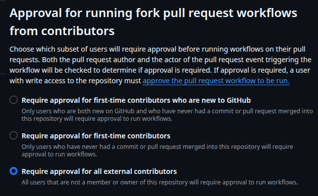

# Reto 2 · CI y flujo de PRs

> **Rama:** `feat/phase-02-ci`. Al terminar, abre una PR contra `main` con una descripción. Es la última PR que podrá entrar sin pasar por las reglas que tú vas a definir.
> **Cuando termines:** di «listo para review».

## Contexto

Hoy la calidad de CrateDigger depende de que pre-commit se ejecute en tu máquina. Eso es una cortesía, no una garantía: `git commit --no-verify` se lo salta, un clon nuevo no tiene los hooks instalados y nadie comprueba que los tests pasen en un entorno que no sea el tuyo. La PR #1 se pudo mergear sin que ninguna máquina ajena ejecutara nada.

La Fase 1 dejó el terreno preparado, y este reto parte de ahí:

- El marker `integration` separa los tests que necesitan PostgreSQL y MongoDB reales. La suite `-m "not integration"` corre sin infraestructura en medio segundo.
- `EnvSettings` tiene 7 variables obligatorias y `extra="forbid"`. En el CI no hay `.env`.
- `compose.yaml` fija `postgres:17.11-trixie` y `mongo:7.0.43-jammy`. En la PR #1 te comprometiste a automatizar su actualización en esta fase.
- `addopts` lleva `--cov` y `--cov-fail-under=85` con tu nota «temporal, después irá solo en CI».
- gitleaks solo mira lo que está en *staging*. El historial completo no lo escanea nadie.
- El merge de la Fase 1 quedó en `main` como `Merge phase 01: local infrastructure and configuration (#N)`: un asunto que no es convencional y que conserva un `#N` literal. Tenlo delante cuando elijas la estrategia de merge.

En GitHub, el repo no tiene ninguna regla: no hay rulesets, los tres métodos de merge están permitidos y las ramas no se borran al mergear.

## Objetivo

Que nada entre en `main` sin pasar por una PR con el CI en verde, y que eso lo garantice GitHub y no tu disciplina.

## Requisitos

### 1. Workflow de CI

- Un workflow de GitHub Actions que se ejecute en las PRs contra `main` y en los push a `main`.
- uv instalado en una versión fijada, con **caché** ligada al lockfile.
- Las dependencias se instalan de forma que el job **falle** si `uv.lock` no está sincronizado con `pyproject.toml`.
- La versión de Python sale de una única fuente de verdad, la que ya tiene el repo. No se repite a mano en el workflow.
- Permisos del `GITHUB_TOKEN` reducidos al mínimo que el workflow necesita, declarados de forma explícita.
- Un push nuevo a una PR cancela la ejecución anterior que siga en curso.
- Cada job tiene un límite de tiempo explícito.
- Las actions de terceros van fijadas a una versión concreta (pregunta de diseño 3).

### 2. Qué se comprueba

- **Calidad:** lint, formato y tipos. Tú decides si con pre-commit, con las herramientas directamente o con una mezcla (pregunta de diseño 1). Lo que se ejecute en CI y lo que se ejecute en local no pueden divergir en versiones.
- **Tests unitarios:** se ejecutan **sin** servicios levantados. Si un test unitario necesita una BD, el CI debe delatarlo.
- **Tests de integración:** contra PostgreSQL y MongoDB como *service containers*, en las **mismas versiones** que `compose.yaml` y con healthchecks: los tests no pueden arrancar antes de que los servicios estén listos.
- **Cobertura:** el umbral del 85 % se exige en el CI. Resuelve la nota «temporal» de `addopts` y decide dónde y sobre qué datos se evalúa (pregunta de diseño 2).

### 3. Configuración y secretos en el CI

- Las variables que `EnvSettings` exige llegan por entorno.
- **Sin GitHub Secrets y sin secretos reales**: las credenciales de los servicios del CI son de usar y tirar, y deben verse como tales.
- Un job que escanee secretos en el **historial completo** del repo, no solo en el último commit.

### 4. Actualización automática de dependencias

- Configura Dependabot o Renovate (tú eliges y justificas) para cubrir, como mínimo, las dependencias de Python y las actions del workflow.
- Las imágenes de `compose.yaml` y los hooks de pre-commit: comprueba en la documentación de la herramienta que elijas si los soporta. Si alguno no se puede cubrir, documenta cómo lo mantendrás al día.
- Con una cadencia y una agrupación que no te inunden de PRs.

### 5. Flujo de PRs

- Una plantilla de PR que pida lo que tu Definition of Done exige. Corta: una plantilla que nadie rellena no sirve.
- Un **ruleset** sobre `main` que:
  - Exija PR para cualquier cambio.
  - Exija en verde los checks del CI que tú decidas (pregunta de diseño 5).
  - Impida el force-push y el borrado de la rama.
  - Se te aplique **también a ti**, que eres admin del repo.
- Una estrategia de merge elegida, justificada en el README y **reflejada en los ajustes del repo**: los métodos que descartes quedan deshabilitados. Decide también qué pasa con la rama tras el merge.

### 6. Documentación

- El badge del CI en el README, apuntando a `main`.
- La fila «CI» del stack actualizada y una sección breve sobre el flujo de contribución: rama, PR, checks y estrategia de merge.
- Las respuestas a las preguntas de diseño, en la PR o al final de este archivo.

## Criterios de aceptación

- [x] El workflow se ejecuta en la PR de esta fase y termina en verde. Enlaza el run en la PR.


- [x] Una **PR de prueba** con un test roto a propósito queda con el check en rojo y el botón de merge bloqueado. Tras arreglarlo, pasa. Enlaza la PR y pega una captura o la salida de `gh pr checks` de ambos estados. La PR de prueba se cierra sin mergear.

PR de prueba #3 (test: verify CI gates (do not merge)), cerrada al final sin mergear.

Se altera el `assert` de un test unitario de la suite para que falle el job `Unit tests` en CI.

```bash
> gh pr checks

Some checks were not successful
0 cancelled, 1 failing, 3 successful, 1 skipped, and 0 pending checks

   NAME                                        DESCRIPTION  ELAPSED  URL
X  ci/Unit tests (pull_request)                             12s      https://github.com/P-Drop/cratedigger/actions/runs/38263940941/job/114861225280
-  ci/Check coverage threshold (pull_request)                        https://github.com/P-Drop/cratedigger/actions/runs/38263940941/job/114861598307
✓  ci/Check code quality (pull_request)                     33s      https://github.com/P-Drop/cratedigger/actions/runs/38263940941/job/114861224688
✓  ci/Detect leaked secrets (pull_request)                  5s       https://github.com/P-Drop/cratedigger/actions/runs/38263940941/job/114861224980
✓  ci/Integration tests (pull_request)                      52s      https://github.com/P-Drop/cratedigger/actions/runs/38263940941/job/114861225055
```
Se demuestra que el job `Unit tests` falla y que el job `Check coverage threshold`, que depende de los jobs de tests, queda **skipped**. Esto es relevante, porque si el job `Unit tests` no tuviera el check obligatorio, el merge a main estaría habilitado, el estado **skipped** no bloquea.

```bash
# Log del error en el Job
FAILED tests/test_smoke.py::test_database_backend_is_postgresql - AssertionError: assert 'postgresql' == 'funkydb'
```
En la web, el botón `merge pull request` está deshabilitado con el mensaje: 'Merging is blocked due to failing merge requirements'.

Después se revierte el cambio y se comprueba que los checks pasan.

```bash
> gh pr checks --watch

All checks were successful
0 cancelled, 0 failing, 5 successful, 0 skipped, and 0 pending checks

   NAME                                        DESCRIPTION  ELAPSED  URL
✓  ci/Check code quality (pull_request)                     21s      https://github.com/P-Drop/cratedigger/actions/runs/38264787223/job/114864098181
✓  ci/Check coverage threshold (pull_request)               10s      https://github.com/P-Drop/cratedigger/actions/runs/38264787223/job/114864348630
✓  ci/Detect leaked secrets (pull_request)                  7s       https://github.com/P-Drop/cratedigger/actions/runs/38264787223/job/114864097746
✓  ci/Integration tests (pull_request)                      35s      https://github.com/P-Drop/cratedigger/actions/runs/38264787223/job/114864097985
✓  ci/Unit tests (pull_request)                             19s      https://github.com/P-Drop/cratedigger/actions/runs/38264787223/job/114864098119
```

El botón ahora se muestra habilitado.

- [x] Un `git push` directo a `main` es rechazado. Pega la salida.

```bash
> git push origin main

Enumerando objetos: 1, listo.
Contando objetos: 100% (1/1), listo.
Escribiendo objetos: 100% (1/1), 434 bytes | 434.00 KiB/s, listo.
Total 1 (delta 0), reusados 0 (delta 0), pack-reusados 0
remote: error: GH013: Repository rule violations found for refs/heads/main.
remote: Review all repository rules at https://github.com/P-Drop/cratedigger/rules?ref=refs%2Fheads%2Fmain
remote:
remote: - Changes must be made through a pull request.
remote:
remote: - 5 of 5 required status checks are expected.
remote:
To github.com:P-Drop/cratedigger.git
 ! [remote rejected] main -> main (push declined due to repository rule violations)
error: falló el empuje de algunas referencias a 'github.com:P-Drop/cratedigger.git'
```

- [x] Un job que modifica `pyproject.toml` sin regenerar `uv.lock` falla. Demuéstralo en la PR de prueba o en un run enlazado.

Se realiza sobre la PR de prueba #3 (test: verify CI gates (do not merge)), cerrada al final sin mergear.

Se ha añadido manualmente una dependencia adicional a `pyproject.toml`, commiteando con `--no-verify` para evitar la comprobación y sincronización local del lockfile.

```bash
> gh pr checks

Some checks were not successful
0 cancelled, 3 failing, 1 successful, 1 skipped, and 0 pending checks

   NAME                                        DESCRIPTION  ELAPSED  URL
X  ci/Check code quality (pull_request)                     16s      https://github.com/P-Drop/cratedigger/actions/runs/38265414536/job/114866223293
X  ci/Integration tests (pull_request)                      32s      https://github.com/P-Drop/cratedigger/actions/runs/38265414536/job/114866223367
X  ci/Unit tests (pull_request)                             10s      https://github.com/P-Drop/cratedigger/actions/runs/38265414536/job/114866223284
-  ci/Check coverage threshold (pull_request)                        https://github.com/P-Drop/cratedigger/actions/runs/38265414536/job/114866458904
✓  ci/Detect leaked secrets (pull_request)                  7s       https://github.com/P-Drop/cratedigger/actions/runs/38265414536/job/114866223479
```

Botón `merge PR` -> deshabilitado

```bash
# Log del error en los jobs con 'uv sync' en el step 'Install project'
error: The lockfile at `uv.lock` needs to be updated, but `UV_LOCKED=1` was provided.
```

- [x] La segunda ejecución del workflow muestra *cache hit* en uv. Anota en la PR el tiempo total con la caché fría y con la caché caliente.

| Ejecución | Tiempo step *Install project* | Tiempo total | *Cache hit* |
| --- | --- | --- | --- |
| Frío | 3s | 1m 3s | - |
| Caliente | 2s | 55s | 47.87 MiB |

- [x] Los tests unitarios pasan en un job que no tiene servicios; los de integración, en uno que los tiene. Ningún test queda sin ejecutarse: el número total coincide con el de `uv run pytest` en local.

`Unit tests` sin servicios, falla si un test requiere base de datos (70 test unitarios).

`Integration tests` utiliza los servicios con la versión de las imágenes sincronizada con `compose.yaml` por Renovate (6 tests de integración).

El total 70 + 6 = 76 coincide con la ejecución local.

- [x] El CI falla si la cobertura baja del 85 %. Explica en la PR cómo lo comprobaste.

Se comprueba también sobre la PR de prueba #3 (test: verify CI gates (do not merge)), cerrada al final sin mergear.

Se han creado nuevas líneas de código sin cubrir por módulos de test para reducir la cobertura total.

```bash
> gh pr checks --watch

Some checks were not successful
0 cancelled, 1 failing, 4 successful, 0 skipped, and 0 pending checks

   NAME                                        DESCRIPTION  ELAPSED  URL
X  ci/Check coverage threshold (pull_request)               12s      https://github.com/P-Drop/cratedigger/actions/runs/38267305417/job/114872923129
✓  ci/Check code quality (pull_request)                     21s      https://github.com/P-Drop/cratedigger/actions/runs/38267305417/job/114872583405
✓  ci/Detect leaked secrets (pull_request)                  5s       https://github.com/P-Drop/cratedigger/actions/runs/38267305417/job/114872583565
✓  ci/Integration tests (pull_request)                      48s      https://github.com/P-Drop/cratedigger/actions/runs/38267305417/job/114872583604
✓  ci/Unit tests (pull_request)                             18s      https://github.com/P-Drop/cratedigger/actions/runs/38267305417/job/114872583597
```

Se demuestra que el único job que falla es `Check coverage threshold`, reforzando la decisión de definir este check como obligatorio para bloquear el merge.

| Name                               |    Stmts |     Miss |   Cover |   Missing |
|----------------------------------- | -------: | -------: | ------: | --------: |
| cratedigger/core/coverage\_demo.py |      166 |      166 |      0% |     4-169 |
| **TOTAL**                          |  **329** |  **166** | **50%** |           |

```bash
# Log del error en el job 'Check coverage threshold'
Coverage failure: total of 50 is less than fail-under=85
```

- [x] El workflow no usa ningún secreto de GitHub y sus `permissions` están declarados.

Ningún `secrets.` en `ci.yaml`, todas las variables de entorno declaradas con valores desechables. Se declaran los permisos:

```bash
# Nivel workflow
permissions: {}

# Nivel de job que requiere checkout del código
permissions: contents: read
```

- [x] El escaneo de secretos recorre todo el historial y pasa.

```bash
> gitleaks git --redact --verbose

5:59PM INF 97 commits scanned.
5:59PM INF scanned ~429836 bytes (429.84 KB) in 548ms
5:59PM INF no leaks found
```

- [x] `gh api repos/P-Drop/cratedigger/rulesets` muestra el ruleset activo. Pega en la PR el detalle de sus reglas y de quién puede saltárselas.

```bash
{
  "id": 24931400,
  # Ruleset activo sobre la rama main
  "name": "main",
  "target": "branch",
  "source_type": "Repository",
  "source": "P-Drop/cratedigger",
  "enforcement": "active",
  "conditions": {
    "ref_name": {
      "exclude": [],
      # Aplica a la rama main
      "include": [
        "~DEFAULT_BRANCH"
      ]
    }
  },
  "rules": [
    # Regla que impide el borrado de la rama
    {
      "type": "deletion"
    },
    # Regla que impide force push
    {
      "type": "non_fast_forward"
    },
    # Regla para PR, con merge commit como único método permitido
    {
      "type": "pull_request",
      "parameters": {
        "required_approving_review_count": 0,
        "dismiss_stale_reviews_on_push": false,
        "required_reviewers": [],
        "require_code_owner_review": false,
        "require_last_push_approval": false,
        "required_review_thread_resolution": false,
        "require_extra_approval_for_unattributed_changes": true,
        "allowed_merge_methods": [
          "merge"
        ]
      }
    },
    # Regla para que el merge de la PR requiera que checks de CI (generados por Github Actions)
    {
      "type": "required_status_checks",
      "parameters": {
        "strict_required_status_checks_policy": true,
        "do_not_enforce_on_create": false,
        "required_status_checks": [
          {
            "context": "Check code quality",
            "integration_id": 15368
          },
          {
            "context": "Detect leaked secrets",
            "integration_id": 15368
          },
          {
            "context": "Unit tests",
            "integration_id": 15368
          },
          {
            "context": "Integration tests",
            "integration_id": 15368
          },
          {
            "context": "Check coverage threshold",
            "integration_id": 15368
          }
        ]
      }
    }
  ],
  "node_id": "RRS_lACqUmVwb3NpdG9yec5SQwanzgF8bEg",
  "created_at": "2026-10-12T15:47:34.919+02:00",
  "updated_at": "2026-10-12T15:47:35.026+02:00",
  # Ruleset sin excepciones a mi nombre
  "bypass_actors": [],
  "current_user_can_bypass": "never",
  "_links": {
    "self": {
      "href": "https://api.github.com/repos/P-Drop/cratedigger/rulesets/24931400"
    },
    "html": {
      "href": "https://github.com/P-Drop/cratedigger/rules/24931400"
    }
  }
}
```

- [x] `gh repo view --json squashMergeAllowed,mergeCommitAllowed,rebaseMergeAllowed,deleteBranchOnMerge` refleja la estrategia que describes en el README.

```bash
{
  "deleteBranchOnMerge": true,
  "mergeCommitAllowed": true,
  "rebaseMergeAllowed": false,
  "squashMergeAllowed": false
}
```

- [ ] La configuración de actualización de dependencias está en `main` y la herramienta ha abierto, o ha informado de que no necesita abrir, su primera PR.
- [x] El badge del README se ve bien **renderizado** en GitHub y enlaza al workflow.
- [x] `uv run pre-commit run --all-files`, `uv run mypy .` y `uv run pytest` siguen en verde en local.

- [x] Commits atómicos y convencionales, con asuntos de **72 caracteres como máximo**. La PR está descrita con tu plantilla.

## Restricciones

- Solo GitHub Actions con runners alojados por GitHub. Sin servicios de CI externos.
- Sin GitHub Secrets.
- Sin `docker compose` dentro del CI: los servicios son *service containers* del workflow.
- Sin `continue-on-error` ni condiciones que dejen un check en verde cuando algo ha fallado.
- No se rebaja ningún umbral ni se excluye código de la cobertura para que el CI pase.
- No se reescribe el historial publicado de `main`.
- El ruleset no tiene una excepción a tu nombre.

## Preguntas de diseño

Respóndelas en la PR o al final de este archivo.

1. Repasa tu `.pre-commit-config.yaml` hook por hook. ¿Cuáles tiene sentido ejecutar en el CI, cuáles no y cuáles hay que ejecutar de otra forma? Si pre-commit ya lo comprueba todo en local, ¿qué aporta repetirlo en el CI?

Estos son los hooks que tengo configurados para el check de pre-commit:

- pre-commit hooks (yaml, toml, eof, whitespaces, merge conflicts, large files, case conflicts, line ending, detect private keys).

- Hooks de uv: *uv-lock*, regenera el lock; *uv-sync* como hook de `post-checkout` / `post-merge`

- Ruff linter and formatter

- Mypy

- Gitleaks

- Conventional Commits. Hook de `commit-msg`.

De estos, todos utilizan un repositorio remoto excepto Ruff y Mypy que utilizan la configuración local (lockfile + pyproject.toml). Para CI, considero necesarios para el job `Check code quality`:

- pre-commit hooks, desde el repositorio definido en `.pre-commit-config.yaml`. Son comprobaciones de formato de archivos y líneas de código que aseguran un formato estándar y uniforme, algunas complementan a Ruff. Como en CI los archivos no están *staged*, es necesaria la opción `--enforce-all` para la comprobación del tamaño de archivos.

- uv necesario no solo en este job, sino en todos los que ejecuten código del proyecto. El set up se realiza desde el repositorio proporcionado por astral, a partir de la versión definida en `pyproject.toml`, que Renovate mantiene sincronizada con la de `.pre-commit-config.yaml`. La instalación se realiza con `uv sync --locked` (la opción `locked` queda fijada desde el entorno global con `UV_LOCKED: 1` para todas las ejecuciones de `uv run`). Esta opción declara como fuente de verdad el lockfile, fallando ante inconsistencias con `pyproject.toml`.

- Ruff (linter y formatter) y mypy necesarios en el workflow, ejecutándose a partir de la definición de sus hooks, que utilizan la configuración local.

- Gitleaks se ejecuta en CI como medida de detección de la filtración. No es preventivo, porque cuando se ejecuta el workflow, el código (y los secretos filtrados) ya está en la rama remota del repositorio. La ejecución es diferente: en pre-commit, gitleaks utiliza el repositorio en el hook, mientras que en CI realiza una instalación de la herramienta con comprobación del checksum y escanea todo el historial del repositorio. Ambas versiones también se deben mantener sincronizadas, he configurado Renovate para ello.


Por tanto los hooks que no se reutilizan en CI, o que se utilizan de otra manera son:

- `uv-lock`, que regenera el lock. Lo sustituye `uv sync` con `UV_LOCKED`.

- `uv-sync` está definido como hook de `post-checkout` o `post-merge`. Se reemplaza por el step `Install project`.

- El hook de gitleaks comprueba el *staging*, por lo que escanearía **cero commits**. Lo sustituye el job que escanea el historial completo.

<!-- - `conventional-pre-commit` es del stage `commit-msg` y no se puede ejecutar con `pre-commit run` como el resto de hooks. Con *merge commit*, los mensajes llegan a `main` y en este momento no tienen un validador en el servidor. Aquí hay una deuda técnica pendiente. -->

- Todos los hooks u opciones de hooks que modifican archivos, en CI funcionan estrictamente como comprobaciones (`--show-diff-on-failure`). Si tuvieran que cambiar algo, fallan y muestran el error.

Para evitar una lista duplicada de herramientas de validación en `pre-commit` y CI, se utiliza un step en el run que ejecuta todos los hooks, definiendo las excepciones en el archivo `.pre-commit-config.yaml` con la opción `ci: skip: [uv-lock, gitleaks]` (no es necesario excluir `uv-sync` porque es un hook de `post-checkout`, y `conventional-pre-commit` de `commit-msg`). Aunque se ejecuten en un único step, cada comprobación en CI se seguirá mostrando como `Passed` / `Failed`, para descubrir los fallos directamente.

Las comprobaciones de pre-commit se pueden saltar, con la opción `--no-verify` en el commit. Las comprobaciones de CI son la validación real para la rama principal del código del repositorio.

Además, la configuración de `.pre-commit-config.yaml` se ejecuta en un entorno local, que puede tener dependencias que solo son visibles en el entorno simulado de CI (en concreto, esta fase reveló una dependencia de mi configuración de `mypy` con `.env`local, invisible hasta CI). En CI se prueba la instalación desde cero y se valida con independencia del entorno local, por lo que su repetición está justificada.

---

2. ¿Un job o varios? ¿Qué ganas y qué pierdes con cada opción? Si separas los tests unitarios de los de integración, ¿qué mide cada job por separado y cómo consigues que el 85 % se evalúe sobre el total?

He configurado varios jobs, agrupando los steps por su propósito concreto:

- `Check code quality`
- `Detect leaked secrets`
- `Unit tests`
- `Integration tests`
- `Check coverage threshold`

De esta forma, la configuración de cada job se puede adaptar a sus necesidades concretas (p.ej. los servicios de postgres y mongo solo se instalan el job de tests de integración, que es el único que lo necesita). Aunque la configuración es más compleja, queda más legible con steps agrupados que con una lista enorme de steps para un solo job. Además los fallos quedan más localizados, y aseguran que se producen en las condiciones que prueba el job. Hay configuraciones globales, como las variables de entorno que se repiten en varios jobs o los permisos por defecto. El inconveniente de definir las variables de entorno globales, es que también se encuentran accesibles para los jobs que no los requieren, como el la detección de filtración de secretos. Se acepta este trade-off a cambio de simplificar y no repetir código, siendo los valores de las variables falsos y desechables.

Los jobs de test unitarios e integración se encuentran separados. Cada uno ejecuta la suite definida por sus módulos: los unitarios prueban lógica de negocio y funcionalidades concretas, con conexiones externas y datos mockeados, mientras que los de integración prueban el flujo con la conexión real (solo en integración se requieren servicios de bases de datos). Gracias al plugin de `pytest-cov` (usa `coverage.py`) es posible que cada job mida su propia cobertura, que pueden ser combinadas después para medir la cobertura total y compararla con el 85% total (definido en `pyproject.toml` como `[tool.coverage.report] -> fail_under`). Cada job genera un archivo de datos (definido en `COVERAGE_FILE` como `.coverage.unit` o `.coverage.integration`) al ejecutar la suite con `pytest` y la opción `--cov-fail-under=0`, para que no aplique la cobertura total sobre sus datos parciales. En cada job, este archivo se sube como artefacto de la run, después un job `Check coverage threshold`, que se ejecuta cuando los dos jobs de tests terminan con éxito, descarga los artefactos, combina los archivos y genera el reporte completo, que compara el resultado con el threshold definido. Para compartir los artefactos entre jobs, utilizo herramientas de Github Actions (`upload-artifact` y `download-artifact`).

Una ventaja de separar los jobs, es que se ejecutan en paralelo: el tiempo total no es la suma de los jobs, sino el camino más largo. Además, el job de test unitarios puede revelar si un test definido en el modulo requiere el uso de base de datos, porque el job no tiene estos servicios y fallaría.

Por contra, hay steps que se repiten en los jobs, como `checkout`, setup de `uv`, `uv sync`. También la configuración del job de cobertura, que necesita toda la infraestructura de `artifacts` para combinar los archivos de otros jobs.

---

3. Al referenciar una action, ¿qué diferencia hay entre fijarla a una rama, a un tag o al SHA de un commit? ¿Qué elegiste y qué riesgo aceptas? Enlázalo con lo que aprendiste sobre los tags de las imágenes de Docker.

Al referenciar una action, como ocurre con una imagen de docker, se puede hacer de manera más o menos específica. Cada una implica lo siguiente:

- Fijar una rama: no especifica versión, la rama puede estar en desarrollo y puede implementar en cualquier momento un cambio que provoque una inconsistencia en el workflow. Esta opción es útil para pruebas rápidas, pero descartada para desarrollo profesional y producción.

- Fijarla al tag: especifica la versión de una release. Evita los cambios de desarrollo habituales de la opción de fijar a una rama. Pero un tag es móvil, el mantenedor o incluso un atacante, podrían moverlo a otro commit y el tag pasa a apuntar a otro código. Si la corrección implica un nuevo tag, Renovate la detecta y propone la actualización, pero si se hace sobre la misma release, puede provocar inconsistencias difíciles de detectar. Ocurre igual para imágenes de Docker, el tag `17.11-trixie` puede reconstruirse bajo el mismo nombre, a diferencia del *digest* y el SHA, que fijan una versión inalterable. Lo ocurrido en 2025 con `tj-actions/changed-files` demuestra el riesgo real de utilizar un tag móvil, que puede ser vulnerado para apuntar a una fuente de código maliciosa.

- Fijar al SHA de un commit: especifica un código fuente específico, el commit es inalterable. Equivale a fijar una imagen al digest, obteniendo una fuente estable para la herramienta externa. La desventaja es que es menos legible y que hay que modificar el SHA para actualizaciones y parches de seguridad. Esta es la opción que he elegido, comentando el SHA con la versión para legibilidad y configurando Renovate para que rastree la actualización de las dependencias.

Los riesgos que acepto con la opción de fijar la action con SHA:

- Estoy fijando el SHA de la action, pero no puedo fijar lo que esta action descargue.

- A la hora de obtener el SHA, hay que asegurarse que corresponde al tag del repositorio original y no proviene de un fork externo. He utilizado `git ls-remote` para obtener los SHA de la versión oficial.

- La opción fijar SHA y Renovate implica quedarme con versiones antiguas hasta que mergee el PR de Renovate.

---

4. ¿Qué diferencia hay entre los eventos `pull_request` y `pull_request_target`? ¿Por qué importa en un repo público que acepta PRs desde forks, y qué tiene que ver con que tu CI no necesite secretos?

Estos triggers se ejecutan al realizar o actualizar una PR, pero la diferencia está en el contexto de ejecución: `pull_request` se ejecuta en un contexto simulado del merge (rama base + PR), mientras que `pull_request_target` se ejecuta directamente en el contexto de la rama base. Esto implica que la segunda opción es más delicada y menos segura, ya que proporciona acceso al código base y también a los secretos del repositorio, con los permisos de escritura para el GITHUB_TOKEN en un contexto privilegiado. Existe el riesgo de **pwn request**, donde un workflow con `pull_request_target` hace checkout del código de la PR y se ejecuta con privilegios. Por ello debe ser usada solo para tareas de gestión que necesitan permisos y no ejecutan el código fuente del usuario.

En un repositorio público, cualquier usuario puede hacer un fork y enviar una PR. Por tanto, el workflow de CI debe ejecutarse en un entorno que acepte la ejecución de código no confiable, sin proporcionar acceso a los secretos de Github ni permisos sobre el código y la configuración del repositorio.

El CI que he implementado en esta fase no requiere secretos, las variables de entorno que utiliza son valores deliberadamente falsos y desechables. Esto no afecta a mi propio desarrollo, porque como usuario administrador del repositorio, mi PR se ejecuta desde el propio repositorio y tiene acceso a los secretos, incluso en workflow disparado por un evento `pull_request`. El problema viene cuando un colaborador propone cambios con una PR desde un fork, el workflow de CI siempre fallaría su comprobación porque desde el fork no tiene acceso a los secretos. En este caso, existe el riesgo de cambiar a `pull_request_target` para permitir que se ejecute un CI que necesita secretos sobre forks, pero un CI sin secretos reales no necesita dar ese paso.

De esta manera, puedo confiar en que el código de un fork se evalúa en el workflow de CI sobre un entorno seguro, sin dar acceso a los secretos del repositorio ni bloquear las run de los fork de colaboradores.

---

5. ¿Qué checks marcaste como obligatorios en el ruleset y por qué esos? ¿Qué pasa con un check obligatorio si su job no llega a ejecutarse (por un filtro de rutas, por ejemplo)? ¿Exiges que la rama esté al día con `main` antes de mergear? ¿Qué coste tiene?

De los cinco jobs que he definido en el workflow, he marcado todos como checks obligatorios en el ruleset. Los motivos son los siguientes:

- `Check code quality`: Comprueba el estilo, el formato, el tipado, las reglas de ruff, pre-commit... Si no es obligatorio, un PR con código que no respete mis reglas de calidad puede llegar a main.

- `Detect leaked secrets`: Como ya he mencionado, no es prevención, sino detección (algo tardía) de un secreto filtrado en la rama del PR que no desaparece del historial aunque se rote. Hay que aplicar rotación, análisis del alcance y limpieza. Pero además de la detección, bloquear el merge a main de esta PR frena la expansión del efecto del secreto filtrado, la rama main queda limpia.

- `Unit tests` e `Integration tests`: Suites de test que comprueban las funcionalidades de la aplicación. Es obligatorio que el código que llegue a main no rompa los tests.

- `Check coverage threshold`: Mide el porcentaje de la base de código cubierta por los módulos de test. El umbral permite flexibilidad, se puede implementar código nuevo sin pruebas, pero al menos un 85% de la base de código debe estar cubierta en main. Hacerlo obligatorio ha requerido reflexión, porque el job depende de los jobs de tests, entonces podría omitir la obligatoriedad de esos jobs. Pero el punto está en queda como **skipped** si falla un job de test, que para los checks cuenta como **success**. Por eso este y los dos jobs de tests deben ser obligatorios.

Para un check obligatorio en el que un job no llega a ejecutarse (como en el ejemplo del filtro de rutas, donde el cambio no se produce en la ruta y no ejecuta sus jobs), el estado que queda es **pending** para siempre. La PR no acepta el merge porque se queda bloqueada por el estado de un check que nunca se va a ejecutar. Es un problema conocido en devops y tiene soluciones concretas, como aplicar condicionales en el workflow para que quede **skipped** (equivale a **success** para el check) o Dummy Workflows.

He decidido exigir que la rama esté actualizada con `main` como requisito para el merge. El coste para este proyecto es mínimo en este punto: un solo desarrollador, con PR amplias por fase de desarrollo propuesta por el tutor y push directos a main bloqueados en la configuración del repositorio. La rama main se queda desactualizada cuando existen varias ramas de desarrollo, y un desarrollador mergea una PR mientras se realizan las comprobaciones de una segunda rama, de forma que aunque el run de la segunda rama quede en verde, el merge está bloqueado porque main ya no está al día. Este es el trade-off, que acepto porque no influye en el flujo de desarrollo actual.

A cambio, obtengo un main estable y una rama de desarrollo siempre actualizada con la fuente de verdad que representa la rama base. Como `pull_request` prueba el *merge commit* en el momento del run. Dos PRs que se encuentren simultáneamente en verde, podrían provocar un conflicto semántico juntas y romper `main` con el merge. Al exigir la actualización con `main`, el primer merge funciona, pero la segunda rama se encontraría desactualizada y bloquearía el merge de la PR, que debe volver a ejecutar el CI y en este caso se rompería y quedaría la PR en rojo. Para resolver la desactualización, se debe actualizar la rama con un *rebase* desde `main` (*rebase* para evitar meter *merge commits* de la rama base en la rama de desarrollo). Después, volver a ejecutar el run de CI y mergear cuando este verde.

Existe una alternativa profesional para el escenario que he descrito. La estrategia *merge queue* permite crear ramas temporales con un prefijo especial para automatizar la combinación de solicitudes de PR y asegurarse de que no se producen interrupciones en la rama por cambios incompatibles. Esta estrategia es útil cuando existe un gran número de solicitudes de PR simultáneas por rama, aunque la mencione queda descartada para mi proyecto.

---

6. Squash, merge commit o rebase: ¿qué queda en `main` con cada uno y qué pasa con tus commits atómicos? ¿Cómo evita tu elección que se repita un asunto como el de `aa61ff7`? ¿Qué papel juega entonces el título de la PR?

- Merge commit: Mantiene los commits atómicos. En main queda un historial no lineal que agrupa los commits de la PR en un commit de Merge. Consultar solo el historial de commits de PRs con `git log --first-parent --oneline main`.

- Squash merge: En main queda un solo commit que comprime todos los cambios de la PR. Se pierden los commits atómicos, sustituidos por un nuevo mensaje de commit que resume la PR. Es un método utilizado habitualmente en equipos profesionales con PRs pequeñas.

- Rebase merge: Mantiene los asuntos y mensajes de commits atómicos de la PR, reescribiéndolos sobre main. En la reescritura, los commits difieren de la PR porque cambian su SHA. El historial queda lineal porque se pierde la agrupación de commits por PR.

Decido utilizar **merge commit** porque, para este proyecto, las PRs son por fase y con varios temas. Prefiero conservar la granularidad para `bisect` y `blame` sin perder la vista por fases (`--first-parent`). Por contra, acepto un historial no lineal y la obligación de mantener commits limpios.

En la configuración del repositorio, activo solo *merge commit* y configuro el mensaje por defecto como el título de la PR, que utiliza Conventional Commits. Entonces, el título de la PR actúa como el asunto del commit que hace el merge a main.

```bash
> gh api repos/P-Drop/cratedigger --jq '{merge_commit_title, merge_commit_message}'

{
  "merge_commit_message": "BLANK",
  "merge_commit_title": "PR_TITLE"
}
```


7. Dependabot o Renovate: ¿por qué uno y no otro? ¿Mergearías sus PRs de forma automática? ¿Con qué condiciones?

He decidido utilizar Renovate porque permite definir *customManagers*. Esto es importante porque tengo herramientas con su definición de versión duplicada como `gitleaks` (en pre-commit y ci) o la versión de `uv` (en pre-commit y en `pyproject.toml`). Con *customManagers* de Renovate se puede hacer que estas versiones se mantengan sincronizadas. También se pueden agrupar por `groupNames` las imágenes utilizadas tanto en `compose` como en el workflow de ci. Con Dependabot no podía sincronizar las copias duplicadas. A cambio, acepto el coste de instalar una herramienta de terceros (Dependabot es nativo de Github, Renovate no) y tener que gestionar sus permisos de escritura.

Hoy no activaría el merge automático de los PRs de Renovate. La app de Renovate escribe sobre el repositorio y quiero ver su funcionamiento en los primeros PRs. En el caso de activarla, solo para *minors* y *patches* (excluyendo el minor del intérprete de python, que solo se actualiza con aprobación manual en el dashboard), asegurando que pasan todos los checks en verde y estableciendo un tiempo mínimo de espera (`minimumReleaseAge`).

Por otro lado, se bloquea el salto *major* de la imagen de mongo 7, debido al issue ya comentado con mongo 8 y el kernel de linux. Esto evita generar ruido de PR que serían canceladas.

---

8. Tu CI ejecuta código de cualquier PR. ¿Qué podría hacer una PR maliciosa desde un fork con el workflow tal como lo has dejado, y qué se lo impide?

He investigado sobre algunos posibles usos malintencionados de un atacante sobre una PR en un repositorio público:

- Acceso a los secretos de Github del repositorio. Como una PR desde un fork puede modificar y ejecutar `.github/workflows/ci.yaml`, todas las medidas de protección que incluya en este archivo (`timeout-minutes`, `permissions`, `persist-credentials: false`) no son barreras reales contra el atacante. Github impone medidas de seguridad que limitan el impacto del ataque:

  - El token para PR de forks es de solo lectura y sin acceso a secretos, independientemente de los permisos que conceda el workflow.

  - Las aportaciones de contribuidores externos requieren aprobación manual para su ejecución.

  - El runner es una VM efímera sin persistencia entre runs.

  - La caché de un PR no puede envenenar la caché de `main`, solo es visible para ese PR.

  - La configuración estricta del `ruleset` y la revisión manual del diff son medidas importantes para que nada llegue a `main` sin un merge aprobado.

  En el caso de una action de terceros comprometida en mi workflow, las medidas de protección incluidas en el workflow sí pueden actuar como barrera.

- Robar el GITHUB_TOKEN. GitHub limita el token a solo lectura para PRs externas, independientemente del workflow.

- Secuestro de recursos para criptominado en el tiempo de ejecución del workflow. Barreras: revisión de PRs, un cambio malicioso puede superar el CI (ataques comunes en `Dockerfile` o en archivos de test para inyectar un minero), pero cualquier cambio en el código debe ser revisado antes de permitir el merge a main; configuro el repositorio para que las actions requieran una aprobación explicita para todos los contribuidores externos, que aplica a cualquier PR desde un fork, esto detiene la ejecución de un run malicioso y obliga a la aprobación manual, donde la consulta del diff revelaría el código del minero; el atacante podría sobrescribir la configuración del archivo `ci.yaml`, pero en el peor caso, existe un límite de 6h por job gestionado por Github.

- Envenenamiento del supply chain con dependencias maliciosas. El atacante puede proponer un cambio en `pyproject.toml` o en el lockfile (debe estar en ambos sitios para que el CI no falle) y al ejecutar `uv sync` en el job se instala la dependencia. Barreras: como en el caso anterior, la aprobación manual de PRs de forks externas y la revisión del diff. Esto exige que las revisiones de PRs externas se realicen con el máximo cuidado y solo se acepten los cambios conocidos y controlados.

- Exfiltración del contexto del runner, donde el atacante inyecta código malicioso en archivos de código o test, que ejecutan herramientas como `os.environ` para acceder a secretos, o contenido de directorios y los envían a servidores externos con `request` o `urllib`. Barreras: igual que en los casos anteriores, revisar con precaución todas las ejecuciones de PRs de origen desconocido y solo permitir después de analizar y comprender la implementación que proponen.

- Abuso de los servicios de Docker, donde el atacante utiliza la red de docker de los servicios levantados en CI para dirigir ataques DDos hacia el exterior. Barrera: aprobación explícita requerida antes de la ejecución de PRs de forks externos; límite de Github de 6h por job.



## Recursos

- GitHub Actions: [Sintaxis de workflows](https://docs.github.com/en/actions/reference/workflows-and-actions/workflow-syntax) · [Eventos](https://docs.github.com/en/actions/reference/workflows-and-actions/events-that-trigger-workflows) · [Service containers de PostgreSQL](https://docs.github.com/en/actions/tutorials/use-containerized-services/create-postgresql-service-containers) · [Caché de dependencias](https://docs.github.com/en/actions/concepts/workflows-and-actions/dependency-caching) · [Uso seguro](https://docs.github.com/en/actions/reference/security/secure-use) · [Badge de estado](https://docs.github.com/en/actions/how-tos/monitor-workflows/add-a-status-badge)
- uv: [Uso en GitHub Actions](https://docs.astral.sh/uv/guides/integration/github/) · [setup-uv](https://github.com/astral-sh/setup-uv)
- Repositorio: [Rulesets](https://docs.github.com/en/repositories/configuring-branches-and-merges-in-your-repository/managing-rulesets/about-rulesets) · [API REST de reglas](https://docs.github.com/en/rest/repos/rules) · [Métodos de merge](https://docs.github.com/en/repositories/configuring-branches-and-merges-in-your-repository/configuring-pull-request-merges/about-merge-methods-on-github) · [Plantilla de PR](https://docs.github.com/en/communities/using-templates-to-encourage-useful-issues-and-pull-requests/creating-a-pull-request-template-for-your-repository)
- Dependencias: [Opciones de Dependabot](https://docs.github.com/en/code-security/dependabot/working-with-dependabot/dependabot-options-reference) · [Renovate](https://docs.renovatebot.com/)
- Calidad: [pre-commit en CI](https://pre-commit.com/#usage-in-continuous-integration) · [coverage: comandos](https://coverage.readthedocs.io/en/latest/cmd.html) · [gitleaks](https://github.com/gitleaks/gitleaks)
- Imágenes: [mongo en Docker Hub](https://hub.docker.com/_/mongo) (variables y healthcheck del servicio)

## Fuera de alcance

- Matriz de versiones de Python o de bases de datos. Es tema de entrevista, no requisito.
- El build de la imagen de la app en el CI (Fase 10).
- Continuous Delivery y despliegue (Fase 13).
- La colección de Bruno en el CI (Fase 4).
- Publicar la cobertura en servicios externos (Codecov y similares).
- Código de la app: esta fase no debería tocar `cratedigger/` salvo que el CI destape un fallo real.

## Temas de la mini-entrevista

- Continuous Integration, Continuous Delivery y Continuous Deployment.
- Qué debe bloquear un merge y qué no.
- Tests flaky.
- Secretos en el CI y el modelo de confianza de las PRs.
- Caché de dependencias: claves, invalidación y qué se cachea.
- Runners y aislamiento entre jobs.
- Matrices de versiones.
- Estrategias de merge e historial de git.
- «Pasa en mi máquina pero falla en el CI».
- Python core: entornos, intérprete y resolución de imports.
